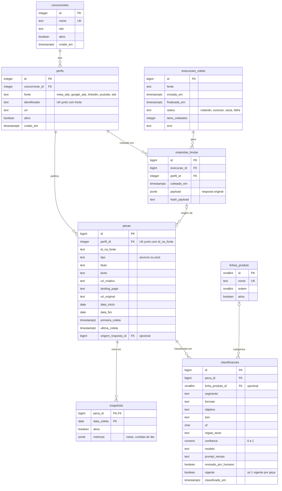

# Schema do banco: `monitor_mkt`

PostgreSQL no mini servidor Windows da empresa, numa database própria, isolada do PRM e do Almoxarifado. O SQL que cria tudo está em `sql/` e é a fonte da verdade; este documento explica o desenho.

> **Para ver o diagrama no VS Code:** instale a extensão *Markdown Preview Mermaid Support* (`bierner.markdown-mermaid`) e abra este arquivo com `Ctrl+Shift+V`. No GitHub o diagrama aparece sozinho.

## Camadas

Os dados passam por três schemas, do bruto ao pronto para o dashboard:

| Schema | O que guarda | Quem escreve | Quem lê |
| --- | --- | --- | --- |
| `bronze` | Resposta original de cada coleta, como veio da fonte. Nunca é alterada. | Coletores | Processamento |
| `prata` | Cadastros, peças sem duplicata, snapshots diários e classificação por IA | Processamento e classificação | Views do `ouro` |
| `ouro` | Views prontas para as perguntas do dashboard | Ninguém (são views) | Power BI |

Guardar o bruto separado permite corrigir um bug ou mudar a classificação e reprocessar o histórico inteiro sem coletar de novo. Isso importa porque anúncios que saem do ar somem das bibliotecas: o que não foi guardado não volta.

## Diagrama

`PK` = chave primária, `FK` = chave estrangeira, `UK` = valor único. Nas linhas, `||` é "exatamente um", `|o` é "zero ou um" e `o{` é "zero ou muitos".

## Tabelas

### `prata.concorrentes`
Um concorrente monitorado. Os 8 iniciais são inseridos por `sql/003_dados_iniciais.sql`. Para parar de monitorar, marque `ativo = false` em vez de apagar: o histórico depende dele.

### `prata.perfis`
Uma conta ou página de um concorrente numa fonte. Existe porque multinacionais (Siemens, Rockwell, Beckhoff, Advantech) têm várias páginas e contas pelo mundo, e só as brasileiras interessam. O `identificador` muda conforme a fonte: id da página na Meta, id do anunciante no Google, slug da página no LinkedIn, id do canal no YouTube ou domínio do site. O par `fonte + identificador` é único. Os perfis são levantados e cadastrados na Fase 0.

### `prata.linhas_produto`
As linhas de produto da taxonomia, mais "Outros". É a única dimensão da classificação com tabela própria, porque é a mais usada no dashboard e muda junto com o portfólio da Portwell.

### `bronze.execucoes_coleta`
Uma execução de um coletor. O coletor cria a linha com `status = 'rodando'` ao começar e atualiza ao terminar. `vazia` significa que rodou sem erro mas não trouxe nada, o que geralmente indica scraper quebrado; é o que dispara o alerta de coleta vazia.

### `bronze.respostas_brutas`
A resposta original da fonte para um perfil, em `jsonb`, sem nenhum tratamento. O `hash_payload` permite pular respostas idênticas à anterior.

### `prata.pecas`
Um anúncio ou post. A regra que evita duplicatas é `UNIQUE (perfil_id, id_na_fonte)`: a coleta roda todo dia e usa `INSERT ... ON CONFLICT` para atualizar em vez de duplicar. `origem_resposta_id` aponta para a resposta bruta de onde a peça saiu pela primeira vez. Quando um anúncio sai do ar, o processamento preenche `data_fim`.

### `prata.snapshots`
Uma peça vista numa coleta. A chave primária é composta (`peca_id + data_coleta`), então existe no máximo um snapshot por peça por dia. É daqui que sai "há quantos dias o anúncio está no ar" e a evolução de métricas públicas. Apagar uma peça apaga seus snapshots (`ON DELETE CASCADE`).

### `prata.classificacoes`
O resultado da IA para uma peça. Reclassificar (prompt novo, modelo novo, revisão humana) cria uma linha nova e marca a anterior com `vigente = false`; um índice único parcial garante no máximo uma classificação vigente por peça, e o histórico de classificações fica guardado. Segmento, formato, objetivo e tom são validados no Python (`src/monitor/taxonomia.py`), não no banco, para a taxonomia poder evoluir sem migração.

## Views do schema `ouro`

| View | Uma linha é | Responde a |
| --- | --- | --- |
| `vw_pecas` | Uma peça com concorrente, fonte, classificação vigente, se está ativa e dias no ar | Base de todas as outras |
| `vw_resumo_concorrente` | Um concorrente (inclusive os sem peças) com totais das últimas 12 semanas | Resumo da visão geral |
| `vw_anuncios_ativos` | Um anúncio no ar agora | Anúncios no ar e mais longevos |
| `vw_semanal` | Concorrente + semana (começando na segunda) | Ritmo de publicação |
| `vw_saude_coleta` | A última execução de cada fonte | Monitorar se a coleta está funcionando |

## Usuários e permissões

| Usuário | Para quê | Acesso |
| --- | --- | --- |
| `monitor_app` | Scripts Python | Dono da database: lê e escreve tudo |
| `monitor_leitura` | Power BI (via gateway) | Só `SELECT` no schema `ouro` |

Ninguém mais conecta na `monitor_mkt` (`REVOKE CONNECT ... FROM PUBLIC`). As views rodam com a permissão do dono, então o Power BI lê o `ouro` sem enxergar `bronze` e `prata`.

## Como mudar o schema

Nunca edite um arquivo de `sql/` que já foi rodado no servidor. Crie o próximo arquivo numerado (`004_...sql`) com a mudança (`ALTER TABLE`, `CREATE VIEW`...), rode no servidor e atualize este documento e o diagrama no mesmo commit.
